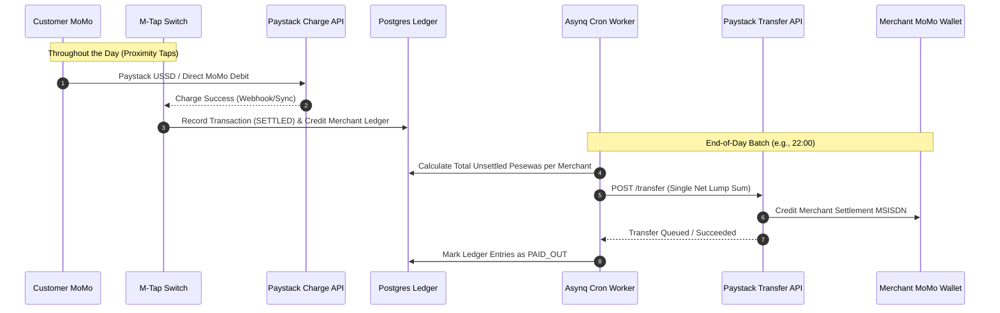
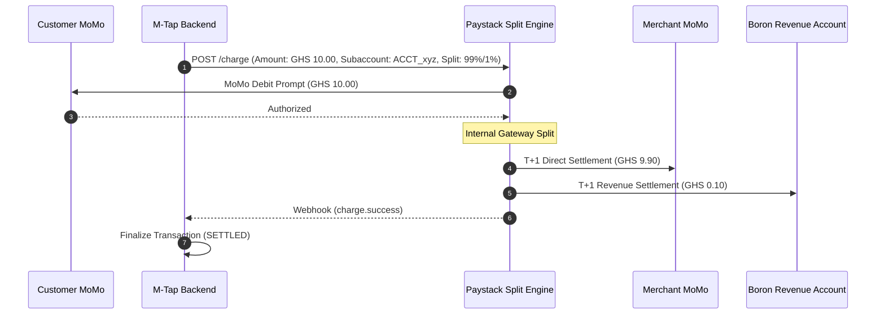
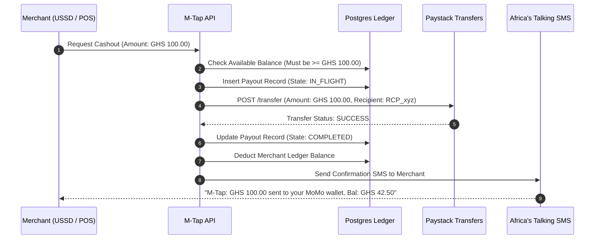

# M-Tap Merchant Payout & Settlement Architectures

This document details the three primary payout and settlement architectures for the **M-Tap** micro-retail switching network in Ghana. It covers operational workflows, API specifications, double-entry ledger tracking, fee economics, regulatory compliance under the Bank of Ghana (BoG Act 987), and implementation blueprints.

---

## 1. Executive Summary & Architecture Overview

In an offline/proximity micro-retail environment (e.g., chop bars, trotro stations, neighborhood kiosks, campus marts), average ticket sizes range from **GHS 2.00 to GHS 50.00**. 

Disbursing funds to the merchant's Mobile Money (MTN MoMo, Telecel Cash, AT Money) on every individual tap is economically unsustainable due to fixed per-transfer fees and network congestion. To address this, M-Tap supports three distinct settlement strategies:

| Metric | Approach 1: Nightly Batch Aggregation | Approach 2: Native Split Subaccounts | Approach 3: On-Demand Cash Out |
| :--- | :--- | :--- | :--- |
| **Model** | Aggregated Master Escrow Pool | Non-Custodial Multi-Party Split | Merchant-Driven Pull Disbursement |
| **Liquidity / Timing** | T+0 End-of-Day (e.g. 10:00 PM) | T+1 Bank / MoMo Settlement | Real-Time / Instant (24/7) |
| **Transfer Fee Impact** | **Minimal** (1 transfer fee per day) | **Zero transfer fee** (built into clearing) | **Moderate** (fee per manual cashout) |
| **BoG Regulatory Role** | Enhanced PSP / Escrow Custody | Intermediary Marketplace | Enhanced PSP / Custodial Ledger |
| **Best Suited For** | High-volume, low-value micro-merchants | Mid-to-high ticket merchants / formal SMEs | Medium-volume merchants needing cashflow |

---

## 2. Approach 1: Nightly Batch Settlement (Master Escrow Model)

### 2.1 Concept
All NFC proximity taps throughout the day debit the customer's MoMo wallet and credit **Boron Labs' Central Operational Collection Account** via Paystack. At the close of business (e.g., 22:00 UTC), an automated batch settlement engine aggregates each merchant's cleared transactions, deducts the M-Tap switching fee, and issues a single bulk payout to the merchant's `settlement_msisdn` via the **Paystack Transfers API**.



### 2.2 Paystack API Implementation

#### Step 1: Create Transfer Recipient (During Merchant Onboarding)
When a merchant registers their `settlement_msisdn`, M-Tap generates a reusable Paystack Recipient Code.

```http
POST https://api.paystack.co/transferrecipient
Authorization: Bearer sk_live_xxxx
Content-Type: application/json

{
  "type": "mobile_money",
  "name": "Kofi Store Kiosk",
  "account_number": "0546007121",
  "bank_code": "MTN",
  "currency": "GHS"
}
```
*Response returns:* `"recipient_code": "RCP_q51j95wgh7g7h8z"`

#### Step 2: Trigger End-of-Day Batch Transfer
The nightly scheduler triggers payouts for all merchants with net accrued balances greater than the minimum payout threshold (e.g. GHS 10.00).

```http
POST https://api.paystack.co/transfer
Authorization: Bearer sk_live_xxxx
Content-Type: application/json

{
  "source": "balance",
  "amount": 495000, 
  "recipient": "RCP_q51j95wgh7g7h8z",
  "reason": "M-Tap Settlement 2026-11-13 [Merchant: MCH-ACCRA-001]",
  "reference": "PAYOUT_MCH001_20261113_BATCH"
}
```
*(Note: Amount is represented in minor units: `495000` Pesewas = `GHS 4,950.00`)*

### 2.3 Double-Entry Ledger Tracking

```
[During the Day: Customer Tap of GHS 50.00 (Platform Fee: 1% = GHS 0.50)]
  DR  Paystack Operational Cash Clearing           5,000 Pesewas
  CR  Merchant Accrued Payable (MCH-001)           4,950 Pesewas
  CR  Boron Labs Platform Revenue                     50 Pesewas

[Nightly Batch Settlement: GHS 4,950.00 Net Payout]
  DR  Merchant Accrued Payable (MCH-001)           4,950 Pesewas
  CR  Paystack Operational Cash Clearing           4,950 Pesewas
```

### 2.4 Advantages & Trade-Offs
- **Pros:**
  - Dramatically lowers telco and clearing fees. 100 taps incur 1 payout fee rather than 100 individual disbursement fees.
  - Full control over platform commission deduction before fund release.
  - Simplified reconciliation (one payout reference per merchant per day).
- **Cons:**
  - Merchant receives funds at end-of-day rather than instantly.
  - Boron Labs temporarily holds custodial float, requiring an Enhanced Payment Service Provider (EPSP) license or bank trustee partnership under Bank of Ghana guidelines.

---

## 3. Approach 2: Native Split Payments (Subaccounts Model)

### 3.1 Concept
M-Tap leverages Paystack's native **Multi-Split Subaccount Engine**. When a merchant is onboarded, an isolated Paystack Subaccount is provisioned. During the customer charge step, M-Tap attaches the merchant's `subaccount_code` and specifies the split percentage. Paystack automatically partitions the funds at the payment gateway level and disburses the merchant's share directly to their MoMo wallet or bank account on Paystack's standard schedule (T+1).



### 3.2 Paystack API Implementation

#### Step 1: Create Merchant Subaccount
```http
POST https://api.paystack.co/subaccount
Authorization: Bearer sk_live_xxxx
Content-Type: application/json

{
  "business_name": "Auntie Mary Provisions",
  "settlement_bank": "MTN",
  "account_number": "0244123456",
  "percentage_charge": 1.0,
  "description": "M-Tap Proximity Merchant Subaccount"
}
```
*Response returns:* `"subaccount_code": "ACCT_4x298f7e21a"`

#### Step 2: Charge with Split Parameters
When the POS triggers a tap transaction, the M-Tap payment processor passes the merchant's subaccount:

```http
POST https://api.paystack.co/charge
Authorization: Bearer sk_live_xxxx
Content-Type: application/json

{
  "amount": 2000,
  "email": "customer_0551234987@mtap.boronlabs.com",
  "currency": "GHS",
  "subaccount": "ACCT_4x298f7e21a",
  "bearer": "subaccount",
  "mobile_money": {
    "phone": "0551234987",
    "provider": "mtn"
  }
}
```

### 3.3 Double-Entry Ledger Tracking

```
[On Tap Charge Execution: GHS 20.00 (Split: GHS 19.80 Merchant, GHS 0.20 Platform)]
  DR  Paystack Receivable (Platform Revenue Share)    20 Pesewas
  CR  Boron Labs Platform Revenue                     20 Pesewas
  * Note: The GHS 19.80 never touches Boron Labs' balance sheet; it is settled
    directly by Paystack to the merchant's designated subaccount.
```

### 3.4 Advantages & Trade-Offs
- **Pros:**
  - **Zero Escrow Risk / Non-Custodial:** Boron Labs never holds merchant funds, avoiding Bank of Ghana deposit-taking and strict custodial float capital requirements.
  - Automated refunds and chargebacks handled directly by the processor.
  - Zero custom batch settlement code required.
- **Cons:**
  - Merchants must wait for Paystack's standard settlement window (typically T+1 morning).
  - Less flexibility to apply dynamic credit offsets, advance financing, or custom micro-fees.

---

## 4. Approach 3: On-Demand Self-Service Cash Out

### 4.1 Concept
Merchants accumulate funds in their internal M-Tap ledger in real time. Whenever the merchant needs working capital (e.g., to buy inventory or pay a supplier), they trigger an instant cashout. This request can be submitted via:
1. **USSD Shortcode** (e.g., `*920*88#` -> Menu: "2. Cash Out").
2. **ESP32 POS Terminal Menu** (Admin key combination on the keypad).
3. **Merchant Web / WhatsApp Portal**.

Upon authorization, M-Tap verifies the available balance, locks the ledger entry to prevent double-spending, and dispatches an instant Paystack transfer.



### 4.2 Handling Concurrency & Double-Spend Prevention
In PostgreSQL, on-demand payouts must use row-level locking (`SELECT ... FOR UPDATE`) inside an isolated transaction to prevent concurrent cashout abuse:

```sql
BEGIN;

-- 1. Lock merchant balance row
SELECT available_balance_pesewas 
FROM merchant_balances 
WHERE merchant_id = 'c7e8a9f0-...' 
FOR UPDATE;

-- 2. Verify sufficient funds
-- If available_balance_pesewas >= requested_pesewas:
UPDATE merchant_balances 
SET available_balance_pesewas = available_balance_pesewas - requested_pesewas,
    updated_at = NOW()
WHERE merchant_id = 'c7e8a9f0-...';

-- 3. Insert audit log and payout entry
INSERT INTO merchant_payouts (merchant_id, amount_pesewas, status, reference)
VALUES ('c7e8a9f0-...', requested_pesewas, 'IN_FLIGHT', 'CASHOUT_REF_123');

COMMIT;
```

### 4.3 Advantages & Trade-Offs
- **Pros:**
  - Highest merchant satisfaction: vendors have instant access to their daily revenue.
  - Ideal for informal sector merchants who require immediate liquidity to restock perishable goods.
  - Ability to charge a nominal convenience fee (e.g., GHS 0.50) per instant cashout, turning disbursements into a revenue stream.
- **Cons:**
  - Requires automated anti-fraud velocity limits (e.g. max 3 cashouts per day).
  - Requires maintaining a pre-funded float in the Paystack Transfer Balance.

---

## 5. Economic & Fee Comparison

The following model compares handling **100 micro-transactions of GHS 10.00 each** (Gross Volume: **GHS 1,000.00**) across the three strategies:

| Parameter | Approach 1: Nightly Batch | Approach 2: Split Subaccount | Approach 3: On-Demand (2 Cashouts) |
| :--- | :--- | :--- | :--- |
| **Gross Volume** | GHS 1,000.00 (100 taps) | GHS 1,000.00 (100 taps) | GHS 1,000.00 (100 taps) |
| **Paystack Collection Fee** | 1.95% = GHS 19.50 | 1.95% = GHS 19.50 | 1.95% = GHS 19.50 |
| **Transfer / Payout Fee** | GHS 1.00 *(1 batch payout)* | GHS 0.00 *(handled by gateway)* | GHS 2.00 *(2 payouts @ GHS 1.00)* |
| **M-Tap Switch Fee (1%)** | +GHS 10.00 | +GHS 10.00 | +GHS 10.00 |
| **Net Received by Merchant** | **GHS 969.50** | **GHS 970.50** | **GHS 968.50** |
| **Transfer Overhead %** | **0.1%** | **0.0%** | **0.2%** |

*(If each GHS 10.00 tap had been disbursed instantly, transfer fees would have amounted to 100 × GHS 1.00 = **GHS 100.00**, eroding 10% of total merchant revenue).*

---

## 6. Regulatory & Compliance Considerations (Bank of Ghana)

1. **Payment Systems and Services Act, 2019 (Act 987):**
   - **Approach 1 & 3 (Custodial / Batch / On-Demand):** Holding merchant funds overnight or pooling money in an operational account falls under Payment Service Provider (PSP - Enhanced) licensing guidelines. Boron Labs must either:
     - Hold an Enhanced PSP license, or
     - Partner with a regulated Tier-1 Ghanaian partner bank (e.g., Stanbic, Ecobank, Zenith) that acts as the custodial trustee of the pooled escrow account.
   - **Approach 2 (Split Payments):** Boron Labs acts purely as a technology routing layer (PSP - Standard / Scheme intermediary). Paystack (licensed by BoG) handles the custody, clearing, and settlement.
2. **E-Levy Compliance:**
   - Under current GRA (Ghana Revenue Authority) guidelines, merchant-to-merchant and commercial settlements to verified registered merchant SIMs are exempt from E-Levy if the merchant's Tax Identification Number (TIN/Ghana Card) is linked to their merchant wallet.
3. **Reconciliation & Audit Trails:**
   - All settlements must record immutable entries in the `audit_logs` table with foreign key linkages to the individual NFC transaction IDs that formed the settlement lump sum.

---

## 7. Recommended Implementation Strategy for M-Tap

### Phase 1: Hybrid Batch + Split (Default Launch Setup)
1. **Default Micro-Merchants (< GHS 500/day):** Deploy **Approach 1 (Nightly Batch Settlement)** scheduled via an Asynq cron worker at 22:00 local time. This minimizes telco fees.
2. **Formal Merchants & Kiosks (> GHS 1,000/day):** Deploy **Approach 2 (Paystack Split Subaccounts)** for hands-off T+1 settlement without platform custody liabilities.

### Phase 2: Self-Service Expansion
- Introduce **Approach 3 (On-Demand Cash Out)** once the merchant balance ledger and SMS notification pipelines have completed full pilot testing.

